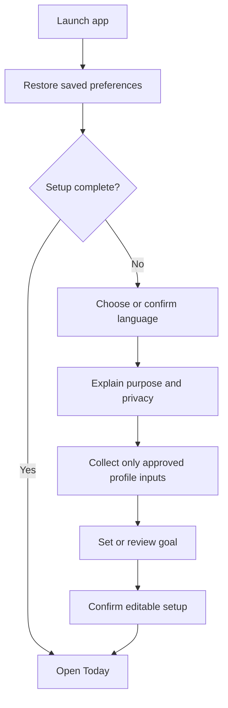
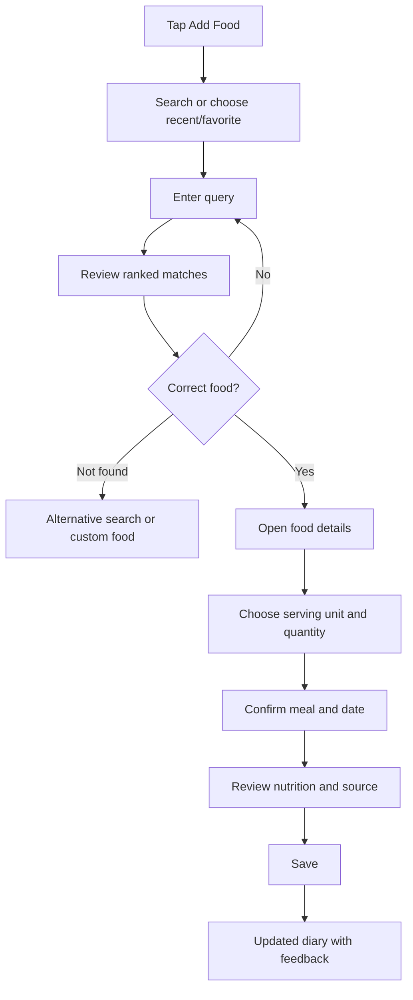
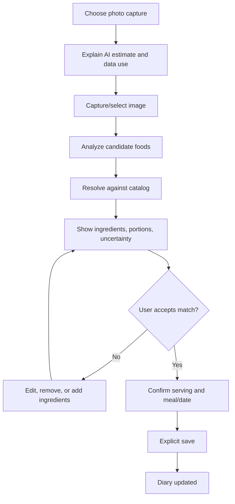

# Core User Journeys and Interaction Contracts

**Status:** Candidate journeys for discovery and implementation planning.  
**Date:** 2026-11-08

These journeys define expected user outcomes and edge cases. They do not imply that screens, services, or data providers already exist. Product-owner decisions and user validation may change the flows.

## 1. Jobs to be done

Avoid inventing demographic personas before research. Start with observable jobs:

- Record what I ate without having to remember nutrition values or do arithmetic.
- Find a food that matches what I actually ate, including local names and portions.
- Understand what has been logged today and what remains against my chosen target.
- Correct an entry when the match or portion is wrong.
- Review changes over time without being shamed or overwhelmed.
- Control my language, appearance, units, personal data, and account.

## 2. Journey A — first launch and setup

**Outcome:** The user reaches a usable diary with understandable, editable settings and no unexplained data collection.

### Interaction contract

1. Restore saved language and theme before rendering the first meaningful frame; avoid a flash of the wrong direction or theme.
2. Offer English and Arabic explicitly. Do not assume a locale choice is permanent.
3. Explain why each profile field is requested before asking for it.
4. Do not ask for age, sex, height, weight, activity level, or other sensitive inputs until the target calculation methodology and necessity are approved.
5. Show the calculated target, assumptions, and ability to edit; do not present a target as a medical prescription.
6. Preserve progress if the app is interrupted.
7. Allow the user to skip optional setup steps where the product can still function safely.

### Failure and edge cases

- App is killed midway through onboarding.
- Locale changes while setup is in progress.
- No network connection (if account/backend dependency is selected).
- Invalid or implausible input.
- User declines optional data collection.
- User wants to change goals later.

## 3. Journey B — log a food from search

**Outcome:** A food is added to the intended meal/date with a transparent serving basis and correct totals.

### Interaction contract

- Search input receives focus promptly and the keyboard does not obscure results or primary actions.
- Results distinguish branded products, generic ingredients, prepared dishes, recipes, and user-created foods.
- Matching should consider Arabic and English names, aliases, spelling variants, transliterations, and common regional terms after data coverage is established.
- Every result has a meaningful display name and enough information to avoid ambiguous selection (e.g., preparation, brand, serving basis).
- Food details show source/provenance, nutrient completeness, and the serving basis.
- Serving quantity and unit are explicit. Never silently interpret “one plate” or “one piece” without a defined conversion.
- Confirm the meal and diary date; inherit context when launched from a meal action.
- Saving is idempotent or protected against repeated taps/retries creating duplicate entries.
- The diary reflects the saved entry and updated totals immediately after a confirmed local save or server acknowledgement, according to the chosen persistence model.

### Failure and edge cases

- No search results.
- Search provider rate-limits or times out.
- Several near-identical matches.
- Missing calories or incomplete macro values.
- Food has no gram conversion for the selected serving.
- User changes the diary date while search is open.
- Save request is submitted twice.
- Save fails after the user has entered serving details.
- Search query contains mixed Arabic/Latin text or diacritics.

## 4. Journey C — quick repeat logging

**Outcome:** A familiar food can be logged with fewer steps while retaining user control.

1. Open Add Food.
2. See recent items and favorites without needing to type.
3. Select the exact saved food.
4. Review the default serving/quantity.
5. Adjust quantity if necessary.
6. Confirm meal/date and save.

Rules:
- Recents must be ordered by actual use, not popularity across other users.
- Favorites are user-controlled.
- Previous serving quantities may be offered as defaults, but must remain visible and editable.
- Do not silently reuse yesterday's meal or serving quantity if context is ambiguous.
- Provide a way to remove an item from recents/favorites without deleting its historical diary entries.

## 5. Journey D — barcode lookup (candidate P1)

**Outcome:** A packaged product is identified, then the user verifies its label-derived nutrition and portion.

1. User explicitly chooses Scan Barcode.
2. Explain camera permission at the point of need.
3. Request permission only when scanning begins.
4. Scan barcode and fetch product data.
5. Display brand/name, serving basis, nutrition completeness, and source.
6. If product is not found or data is incomplete, offer manual label entry or search.
7. User confirms serving and meal/date before save.

Rules:
- Do not treat barcode match as proof of nutritional accuracy.
- Handle denied/restricted camera permission with an explanation and a route to settings where supported.
- Do not upload label photos or contribute product edits without clear user consent.
- Provider selection, regional barcode coverage, API terms, and data quality must be resolved first.

## 6. Journey E — AI/photo meal capture (later phase)

**Outcome:** AI produces an editable draft; the user remains responsible for confirming what was eaten.

Rules:
- Never auto-save model output.
- Distinguish recognized candidates from verified catalog facts.
- Show uncertainty and ask focused questions when ingredients or portion sizes are ambiguous.
- Make every ingredient and quantity editable.
- If analysis fails, preserve the user's draft and offer manual search.
- Do not claim exact calories from an image.
- Do not send profile/diary history to a model unless the specific task requires it and the user has been informed.
- Model, backend, privacy, evaluation, and cost controls are prerequisites.

## 7. Journey F — edit or delete an entry

**Outcome:** The user can correct mistakes without losing context or corrupting totals.

- Open a diary entry.
- Edit food, portion, quantity, meal, or date.
- Recalculate the entry and affected daily totals deterministically.
- Save and show confirmation.
- For delete, make the destructive action explicit; where feasible provide Undo.
- If persistence fails, retain the original entry and show a recoverable error.
- Editing an old entry must not mutate the food catalog record or other historical entries.

## 8. Journey G — diary and daily status

**Outcome:** The user understands the selected day without interpreting a dense dashboard.

The Today screen should make these things clear:
- Selected date and date navigation.
- Daily target and consumed/remaining values, with a clear explanation of the calculation.
- Meal groups and their logged entries.
- One primary add-food action.
- A path to more nutrient detail without showing every nutrient by default.

Rules:
- Use one consistent definition for consumed, target, and remaining.
- Do not mix exercise calories into remaining calories until that product decision is explicit.
- Missing nutrient data must not appear as zero.
- Date changes must use the user's intended local calendar day and must not silently shift entries across time zones.
- Empty day, partially logged day, and fully logged day states are all designed.
- Avoid guilt language, punitive streaks, or warning colors for ordinary eating behavior.

## 9. Journey H — preferences and account controls

**Outcome:** The user can change presentation and control their data.

- Language: English or Arabic, with immediate LTR/RTL update and no loss of current task state.
- Theme: system, light, or dark; preference persists.
- Units: explicit, consistent, and applied without altering the underlying canonical stored values.
- Goals/profile: view assumptions and edit inputs.
- Privacy/account: clear sign-out, recovery, export, and deletion behavior once backend/auth decisions are made.

## 10. Cross-cutting states required for every journey

| State | Required behavior |
|---|---|
| Loading | Explain what is loading when delay is meaningful; keep controls stable and avoid flashing content |
| Empty | Explain why the state is empty and offer one useful next action |
| Error | Use plain language, protect user input, and provide retry or recovery |
| Offline | Make local availability and sync status explicit; do not imply remote save succeeded |
| Permission denied | Explain impact and provide a safe alternative |
| Duplicate/retry | Prevent duplicate food entries and show the final saved state |
| Validation | Place actionable errors near the relevant field; preserve valid input |
| Interrupted | Restore safe drafts and the user's originating context |
| Accessibility | Provide labels, values, focus order, keyboard/screen-reader access, and non-gesture alternatives |
| Reduced motion | Preserve hierarchy and feedback without non-essential movement |

## 11. Motion and microinteraction contracts

Motion should reinforce the user action, not create a performance or cognitive burden.

| Interaction | Feedback intent | Reduced-motion alternative |
|---|---|---|
| Open Add Food | Establish continuity from diary to capture | Short cross-fade or immediate route change |
| Search results update | Make result changes understandable without jumping the layout | Stable list update with no stagger |
| Select a food | Confirm selection and move focus to portion review | Immediate selected state |
| Change quantity | Show updated value and nutrition calculation | Immediate value update |
| Save food | Confirm successful commit and diary update | Static success state/snackbar |
| Delete entry | Clarify removal and expose undo | Immediate removal with accessible undo action |
| Daily totals change | Connect saved entry to updated summary | Immediate totals with semantic announcement |
| Theme/language change | Maintain context while appearance/direction changes | Immediate, non-animated update |

All motion uses shared tokens and is tested on both platforms. Do not animate nutrition values in a way that obscures the final number or implies false precision.

## 12. Critical journey acceptance gates

- New user can reach a usable diary without unnecessary data collection.
- A known food can be searched, portioned, and logged with deterministic totals.
- Repeated save taps cannot create duplicate entries.
- A food entry can be edited and deleted without changing unrelated records.
- Offline and server-failure behavior does not falsely report a successful save.
- Arabic and English flows both complete end-to-end.
- Theme changes do not cause a wrong-theme flash or lose the current task.
- Back navigation and modal dismissal preserve context on iOS and Android.
- Reduced-motion and screen-reader users can complete the same critical tasks.
- AI-generated content remains an editable draft until explicit confirmation.
